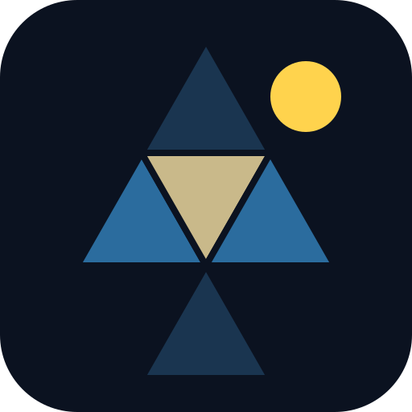

# Fuller Projection Clock

A live world clock drawn on R. Buckminster Fuller's **icosahedral world map (the Fuller Projection, also called the Airocean map)**, showing where it is day, twilight and night right now.



## Features

- **Accurate sun position.** The point where the sun is directly overhead is computed every frame from the Astronomical Almanac's solar formulas (declination, equation of time, sidereal time), accurate to about 0.01°.
- **Day, twilight and night bands.** Shading follows real sun altitudes: sunrise/sunset at −0.833° (includes refraction and the sun's radius), then civil (−6°), nautical (−12°) and astronomical (−18°) twilight.
- **True Fuller Projection layout.** Fuller's icosahedral net using the Gray–Fuller formulas from [d3-geo-polygon](https://github.com/d3/d3-geo-polygon) (`geoAirocean`). Shading is clipped correctly across the cut edges between faces.
- **Zoom and pan.** Scroll, pinch or use the + / − buttons, up to 24×. Lines stay crisp and markers keep their size.
- **Transport layers** (toggle each on or off):
  - **Container shipping lanes** between ~40 of the world's biggest container ports, traced over Eurostat's maritime network with [searoute](https://github.com/genthalili/searoute-py). Thicker lines carry more of the main trade lanes. Indicative, not live vessel tracking.
  - **Flights:** the 2,500 busiest direct airport pairs from the [OpenFlights](https://openflights.org/data.html) route database (2014, ODbL), drawn as great circles. Brighter = more airlines on the route.
  - **Railways** from Natural Earth 1:10m (public domain).
- **Fold into a globe.** One tap folds the Fuller projection net along its real hinges into an icosahedron, inflates it into a sphere and floats it in space (three.js). The globe is lit by the sun from its true direction, with Earth's 23.44° axial tilt shown relative to the sun, so seasons, polar day/night and the terminator are physically correct. Drag to turn it, pinch or scroll to zoom, and it slowly orbits on its own (toggle "Orbit"). The time controls spin it too.
- **The sky around the globe.** In globe view, 1,600 real stars (to magnitude 5, coloured by temperature) and 46 major constellations (the best-known figures, all 12 of the zodiac, Crux and Ursa Minor) surround Earth, with Polaris sitting just off the North Pole. The Moon (with its correct phase, enlarged 4×) and the five naked-eye planets (Mercury, Venus, Mars, Jupiter, Saturn) are shown where they really are at the displayed time. Positions match a full ephemeris (Astronomy Engine) to within about 0.2°. Toggle with "Constellations" and "Moon & planets".
- **Sky from where you are.** In globe view, "Sky from" puts the camera on the far side of Earth looking straight through it along your line of sight, so the stars, constellations, Moon and planets appear exactly as you'd see them looking up from your spot (or any of the 20 cities). The globe turns see-through with your position marked, a horizon hides what's below it, compass points show direction, and the sky turns with real time. Drag to look around; the sky turns blue when the sun is up there.
- **Solar noon line.** The sun's path for ±12 hours, marked with the UTC hour at which it's noon at each spot.
- **World clock.** 20 cities with local civil time (correct time zones and DST) and their current day/night state.
- **Inspect anywhere.** Hover or tap the map for latitude/longitude, local solar time and sun altitude.
- **Time travel.** Fast-forward at 10 min/s up to 30 days/s to watch days and seasons pass, or jump to any date.
- **Your location** (optional) via the browser's geolocation.
- **Installable and offline.** A web app manifest and service worker; all libraries and map data are bundled.

## Run it

It's a static site with no build step. Serve the folder over HTTP (modules and the service worker won't load from `file://`):

```sh
npm start          # python3 -m http.server 8000
# open http://localhost:8000
```

It also works on any static host.

### GitHub Pages

Live at https://mindscape-jdi.github.io/fuller-map-projection/. GitHub Pages publishes straight from the root of `main` (**Settings → Pages → Deploy from a branch**), so every merge to `main` goes live. `.github/workflows/test.yml` runs the tests on every push and PR.

## Test

```sh
npm test
```

Checks the solar maths against almanac values for solstices, equinoxes and the equation of time, the globe's orientation (subsolar point faces the sun, North Pole tilts toward it in June), that the folded net closes exactly into an icosahedron, planet and Moon positions against Astronomy Engine, Moon phases, that Polaris lands next to the North Pole on the globe, and that in the observer view Polaris stands at the observer's latitude and the sun's altitude matches the map.

## Files

| File | Purpose |
| --- | --- |
| `index.html`, `styles.css` | Page and styling |
| `app.js` | Map rendering, time controls, world clock |
| `sun.js` | Solar position and altitude maths, and the Earth-to-scene rotation for the globe |
| `fold.js` | Geometry that folds the Fuller projection net into an icosahedron and sphere |
| `globe.js` | 3D globe view (loaded only when you open it) |
| `sky.js` | Planet (JPL approximate elements) and Moon positions, and sky-to-scene rotations |
| `skyview.js` | Stars, constellations, planets and Moon around the globe |
| `fastfaces.js` | Faster face lookup for the Fuller projection |
| `tools/` | Scripts that rebuild `data/` from the original sources |
| `sw.js`, `manifest.webmanifest`, `icon.svg` | Offline support and install |
| `vendor/` | d3 7.9.0, d3-geo-projection 4.0.0, d3-geo-polygon 2.0.1, topojson-client 3.1.0 (ISC), three.js 0.170.0 (MIT) |
| `data/land-50m.json` | Natural Earth 1:50m land, from world-atlas 2.0.2 (public domain) |
| `data/rail.json` | Natural Earth 1:10m railroads, simplified (public domain) |
| `data/shipping.json` | Container shipping lanes and ports (built with searoute, Apache-2.0; Eurostat MARNET network) |
| `data/flights.json` | Busiest direct routes from OpenFlights (Open Database License) |
| `data/sky.json` | Stars and constellation lines from [d3-celestial](https://github.com/ofrohn/d3-celestial) (BSD-3-Clause, see `data/sky.LICENSE`) |

### Rebuilding the data

```sh
pip install searoute
python tools/build_data.py path/to/openflights   # needs airports.dat and routes.dat
tools/build_rail.sh path/to/ne_10m_railroads.geojson   # needs npx mapshaper
python tools/build_sky.py path/to/d3-celestial/data    # stars.6.json, constellations*.json
```

## Notice

This map uses the Fuller Projection method, originally patented by R. Buckminster Fuller in 1946 (U.S. Patent 2,393,676). “Dymaxion” is a registered trademark of the Buckminster Fuller Institute. This independent project is for personal use and is not affiliated with or endorsed by the Buckminster Fuller Institute.
